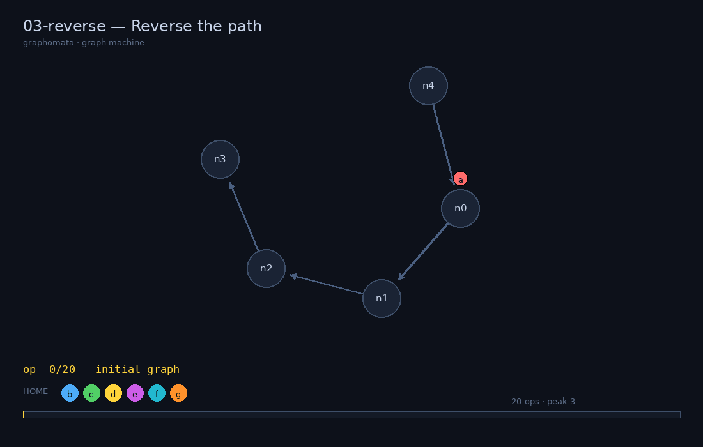

# Graphomata for Programmers — 设计方案

> **一句话**：保留原作的硬约束（7 个 worker、5 个改图原语、随机 WALK、GC），
> 把输入方式从拖拽换成 C++ / Python；图形界面从「编辑器」降级为「回放与调试器」。

本仓库已经把这个方案的**可运行纵切**做出来了：5 个关卡、C++ 与 Python 两套 API、
同一个判定器、逐行成本剖析、trace 回放。`tools/gmj all` 全绿，`tools/gmj diff`
证明两种语言产生**逐帧一致**的操作流。

```text
$ ./tools/gmj diff
01-hello       cpp=  1 ops  py=  1 ops  identical traces
02-chain       cpp=  9 ops  py=  9 ops  identical traces
03-reverse     cpp= 20 ops  py= 20 ops  identical traces
04-clone       cpp= 22 ops  py= 22 ops  identical traces
05-seek        cpp= 17 ops  py= 17 ops  identical traces
```



---

## 1. 原作好在哪，图形化痛在哪

Graphomata 的内核不是「连线」，而是一组非常紧的约束：

| 约束 | 效果 |
| --- | --- |
| 只有 5 个能改变世界的动作：`NODE / WALK / JOIN / LINK / UNLINK` | 表达力被压到极低，每步都必须有理由 |
| 7 个可移动 worker（a–g）+ 1 个不可动的 home（h） | 没有变量、没有栈、没有数组，**寄存器就是全部内存** |
| 图是唯一的内存：节点没人站着、也没有任何边连着，立刻被 GC | 「临时值」必须马上接进图里 |
| `WALK` 沿随机出边移动 | 程序必须对所有分支成立，而不是对一条路径成立 |

这四条叠加，题目自然变成「如何用图本身编码状态」——这是它好玩的原因。

图形化编程的痛则是工程性的：

* **输入带宽低**：一次拖拽 = 一条指令，程序一长就崩溃；
* **不可 diff、不可复用、不可参数化**：改一处要重摆一片；
* **不可单测**：没有断言、没有随机 seed 重放；
* **调试靠肉眼**：没有断点、没有变量、没有成本剖析；
* **不可分享**：截图不是代码，代码不是截图。

但要注意：**只把方块换成汇编文本框，并不解决问题**。社区已经有汇编器和模拟器
（[FireShade3DS/graphomata](https://github.com/FireShade3DS/graphomata)），
`JOIN a, b` 打出来确实比拖出来快，可你仍然在用 7 个寄存器和 2 字节指令思考。
真正的解放是：**让宿主语言承担控制流和数据结构，让 VM 继续当唯一的裁判。**

### 三条路线

| 路线 | 做法 | 评价 |
| --- | --- | --- |
| A. 文本汇编器 | 把方块换成 `.asm` 文本，仍然手工分配寄存器、手写跳转 | 换皮。输入快了，思维负担没变；已有实现 |
| **B. 代码即程序（本方案）** | C++/Python 直接调用 5 个原语；`while`/递归/函数/标准库随便用；按原语计费 | 保留了「图当内存」的题感，去掉了「用方块表达」的折磨 |
| C. 高级语言编译到 ROM | 受限 DSL → 原版字节码，位级兼容 | 与 A 的榜单互通，但要自己实现编译器；作为 M3 可选项 |

本方案取 B，并把 C 留作后路。

---

## 2. 设计原则（三条红线）

1. **语义单一**：C++ 与 Python 必须产生逐帧一致的 op 流。已用差分测试守住
   （`tools/gmj diff`，逐帧比较 workers / nodes / edges）。
2. **代价诚实**：任何语法糖都必须能展开成原语，并按展开计费；不允许「隐形免费操作」。
   `peek(dst, src)` 就是 `JOIN dst,src` + `WALK dst`，2 op，界面里也这么显示。
3. **约束不缩水**：7 个寄存器、随机游走、GC 三条全部保留。它们才是游戏性。

第 2 条带来一个意外的好处：**成本剖析可以精确到源码行**。C++ 用
`std::source_location` 默认参数，Python 用 `sys._getframe(1).f_lineno`，零侵入：

```text
$ ./tools/gmj run levels/03-reverse.json examples/cpp/03_reverse.cpp --cost
    ops per line:
      03_reverse.cpp:15              6   26.1%  ******
      03_reverse.cpp:16              3   13.0%  ***
      ...
```

哪一行贵、贵在哪，和 profiler 的体验一致——这是程序员最熟悉的反馈回路。

---

## 3. 运行时模型

### 3.1 原语与代价

| 原语 | 语义 | 代价 |
| --- | --- | --- |
| `node(w)` | 新建节点，worker `w` 站上去 | 1 |
| `walk(w)` | 沿**随机**出边移动；无出边则回家 | 1 |
| `join(dst, src)` | `dst` 走到 `src` 的位置（`src` 可以是 `h`，即回家） | 1 |
| `link(a, b)` | 在两者所站节点间加边（禁止自环/重边/在家） | 1 |
| `unlink(a, b)` | 删边（边必须存在且方向正确） | 1 |
| `at / test / pos / edges` | 读状态 | 0 |

> 与原版 ROM 的唯一差别：ROM 里 `TEST` 也占一个周期，这里是免费读。
> 因为宿主语言里 `if (w.test(a,b))` 就是一次比较，收费反而别扭。
> 需要和 ROM 榜单对齐时，加一个 `--rom-cost` 开关即可（M2）。

### 3.2 寄存器 = worker 的当前位置

这是整个 API 设计里最关键、也最容易被做错的一点。**寄存器不是变量，是 worker 站的位置。**

```cpp
Cursor prev = w.spare();   // "spare" 只是找了一个正站在 home 的 worker
Cursor nxt  = w.spare();   // 陷阱：又返回同一个 worker
```

`spare()` 是**查询**，不是分配。要拿 k 个不同的空闲寄存器，用 `spares(k)`：

```cpp
auto [prev, nxt, spare] = w.spares<3>();   // C++
prev, nxt, spare = w.spares(3)             # Python
```

没有空闲寄存器时直接抛 `IllegalOp`。玩家因此会自然地写出「什么时候 park 一个 cursor」
的策略——这就是原作的寄存器压力，只不过用编译器能看懂的方式表达。

### 3.3 随机游走

`WALK` 是这台机器唯一的随机源，用 splitmix64 + seed 驱动，两端实现完全一致。
判定时一关跑多个 seed，**全过才算过**。这带来两个设计后果：

* 「碰运气」的解法会在某些 seed 上原形毕露（`05-seek` 就是专门展示这个的关卡，
  20 个 seed 的 op 数从 3 到 33 不等）；
* 出度 > 1 的节点上，**加反向边会污染下一次 WALK**。本仓库的 `03-reverse`
  正是围绕这个陷阱设计的：必须在加反向边*之前*多看一步，否则 WALK 会在
  「向后」和「向前」之间抛硬币。这种题只有代码接口才做得出来——
  用方块摆，你根本意识不到自己在赌。

### 3.4 GC = 堆

节点没人站着、也没有任何边连着，立刻回收。于是：

* 新建的节点必须**在同一条语句里**接上图，否则它在你眨眼之间就没了；
* 想「暂存」一个节点，只能靠 worker 站着，或者先挂一条边；
* 「泄漏」不存在，但「悬空引用」以另一种形式存在：你以为节点还在，其实早就被收了。

这比任何教程都更能教会人「所有权」是什么。

---

## 4. 双语言 API

同一个算法，两边逐行对应（`examples/cpp/03_reverse.cpp` / `examples/py/03_reverse.py`）：

```cpp
void gm_solve(gm::World& w) {
  using namespace gm;
  auto [nxt, spare] = w.spares<2>();
  w.peek(nxt, A);           // nxt := A 的后继
  while (w.at(nxt)) {
    w.peek(spare, nxt);     // 在加反向边之前，读 nxt 的出口
    w.unlink(A, nxt);       // A->nxt 变成 A<-nxt
    w.link(nxt, A);
    w.join(A, nxt);
    w.join(nxt, spare);
  }
}
```

```python
def solve(w: World) -> None:
    nxt, spare = w.spares(2)
    w.peek(nxt, A)
    while w.at(nxt):
        w.peek(spare, nxt)
        w.unlink(A, nxt)
        w.link(nxt, A)
        w.join(A, nxt)
        w.join(nxt, spare)
```

设计取舍：

* **C++**：header-only（`include/graphomata/gm.hpp`，约 390 行），`g++ -std=c++20` 一行编译；
  `std::source_location` 默认参数让每一行自动记账；返回值是 `Cursor`，可以链式写。
* **Python**：无构建、改完即跑；`_getframe` 记账；函数签名 `solve(w: World)`。
* **为什么两端 API 形状一样**：关卡和排行榜必须语言中立。玩家选语言是选工具，
  不是选难度。
* **为什么先做「镜像实现」而不是 pybind11**：镜像 + 差分测试能证明「语义确实只有一份」；
  等语义稳定后再用 pybind11 收编成一份 C++ 核心，跑分和性能都会更好（M2）。
* **浏览器是第三套前端**：`web/` 里是同一台 VM 加一个 Python 子集解释器，
  解释器在每次改图原语后 `yield`，所以「单步」的粒度恰好是一个 op，而不是一行代码。
  三套前端跑同一份关卡，参考解的 op 数完全相同（1 / 9 / 20 / 22）。

---

## 5. 关卡格式与判定

关卡是纯 JSON，可 diff、可 PR、可单元测试：

```json
{
  "id": "03-reverse",
  "title": "Reverse the path",
  "concept": "three-cursor reversal",
  "graph": { "nodes": 5, "edges": [[0,1],[1,2],[2,3],[4,0]], "workers": { "a": 0 } },
  "goal": {
    "iso": { "nodes": 5, "edges": [[0,1],[1,2],[2,3],[4,3]] },
    "workers": { "a": 0 }
  },
  "budget": 26,
  "seeds": [1, 2, 3, 4, 5],
  "hint": "peek 是 JOIN+WALK，花一个寄存器换一次前瞻",
  "reference": { "cpp": "examples/cpp/03_reverse.cpp", "py": "examples/py/03_reverse.py" }
}
```

目标判定有三类原语，够用且好扩展：

| 判定 | 含义 | 用途 |
| --- | --- | --- |
| `iso` | 与目标图**同构**（不看节点编号），可附 `workers` 把 worker 钉到目标的某个位置上 | 形状题 |
| `edges` + `worker_at` | 按节点编号精确比对 | 节点身份有意义的题 |
| `same` | 两个 worker 站在同一节点 | 随机游走题 |

注意 `03-reverse` 为什么要加一个 tag 节点（`4 -> 0`）：只靠「4 个节点的链」做目标，
原图和反转图同构，**什么都不做也能过关**。加一条入边后，两个形状不同构了。
关卡设计里这类「防止平凡解」的构造比题目本身更需要功力。

判定流程：

```text
level.json ──► spec.txt ──► [C++ 编出的可执行文件 | Python 进程] ──► trace.json
                                                                      │
                                    goal 判定 ◄──────────────────────┘
```

`trace.json` 是自包含的：seed、每个 op 之后的完整状态、逐行成本、峰值寄存器。
所以同一份 trace 可以给判定器、给回放器、给排行榜、给 bug 复现。

---

## 6. 计分、判定与防作弊

三个榜单，分别奖励不同的能力：

| 榜单 | 指标 | 说明 |
| --- | --- | --- |
| **Ops** | 通过的 seed 里最大的 op 数 | 主榜，等价于「运行时间」 |
| **Registers** | 峰值同时占用寄存器数 | 次榜，奖励「少开变量」 |
| **Source** | 源码字节数（去注释/空白） | 第三榜，code golf |

判定：一关的所有 seed 都满足 goal 且无 `error`、无超预算，才算 PASS；分数取最坏 seed。

防作弊分两层：

* **本地**：不设防。玩家在自己机器上跑，信任是默认值。
* **在线**：**提交 op-log，而不是提交代码**。trace 里的 op 序列 + seed 就能在服务器上
  确定性重放，几 KB 就能验证。代码只用于本地开发，不需要上传。
  这样 C++ 的原生代码执行风险被彻底绕开；「源码榜」再单独走审核/容器编译。
  这和 TAS 的提交模式（录像而不是实时）是同一个思路。

如果一定要在线跑代码：C++ 编译到 WASM 跑在 wasmtime 里（毫秒级启动、能力为空），
Python 用受限子进程 + rlimit + AST 白名单。

---

## 7. 架构

```text
                 ┌──────────────────────────────┐
   level.json ──► │  judge (Python)              │
                 │  spec 生成 / 多 seed / 判定   │
                 └───────┬──────────────┬───────┘
                         │              │
             ┌───────────▼───┐   ┌──────▼────────┐
             │ C++ harness    │   │ Python runner │
             │ + gm.hpp       │   │ + core.py     │
             │ source_location│   │ _getframe     │
             └───────┬────────┘   └──────┬────────┘
                     └────── trace.json ──┘
                                │
                   ┌────────────┴────────────┐
                   │ 回放器（GIF / HTML）     │
                   │ 逐行成本 / 断点 / 时间旅行│
                   └─────────────────────────┘
```

```
include/graphomata/gm.hpp   VM + 记账 + trace（C++ 单头文件）
python/graphomata/core.py   语义镜像 + goal 判定
python/graphomata/judge.py  CLI：run / test / all / diff / trace / gif / sheet
python/graphomata/viz.py    trace → GIF / storyboard
tools/harness.cpp           C++ 运行入口（spec → trace）
levels/*.json               关卡
examples/{cpp,py}/*         参考解
tests/test_core.py          单元测试
```

关键决策：**语义只写两遍，但用差分测试钉死**。等 M2 再合并成
「C++ 核心 + pybind11 绑定」，那时差分测试就变成了回归测试。

`gm.hpp` 刻意保持无依赖（不用 JSON 库、不用 fmt），因为玩家的第一体验是
`g++ -std=c++20 -O2 main.cpp`，不能有任何构建负担。关卡进 C++ 的通道是一条
极简 `spec.txt`，五行就能读完，也就不需要 JSON 解析器。

---

## 8. 图形界面的新角色：调试器

这是本方案和「纯命令行刷题」最大的区别，也是它仍然是个**游戏**的原因。

| 原版 | 现在 |
| --- | --- |
| 拖拽建图 = 输入 | 回放 = 输出 |
| 手动单步、肉眼找错 | 断点、单步、时间旅行（trace 全量保存，可任意跳转） |
| 没有成本概念 | 每行/每 op 的成本热力，直接叠在图上 |
| 分享一张截图 | 分享一个 trace / 一个 GIF（像 TAS 录像） |

trace 很小（20 个 op ≈ 7 KB JSON），所以「时间旅行」不需要任何特殊架构：
把 trace 读进内存，滑动条就是第几帧。本仓库的 `viz.py` 是最小实现，
真正产品化时换成 Web 前端（canvas + 滑块）即可，数据格式不用变。

建议的调试器功能清单（按优先级）：

1. **回放滑块 + 单步**（已有）
2. **每行成本叠加**：编辑器里显示 `20 ops / 26%`，点击行 → 跳到该行第一次执行的帧
3. **边上色**：本次 op 新增的边绿色、删除的红色（已有）
4. **断点**：`w.breakpoint("03_reverse.py:18")`，或按 op 数 `at_op(17)`
5. **快照对比**：任意两帧 diff，标出 worker 移动/边增删
6. **失败复现**：某个 seed 挂了，直接给出 `--seed` 和出错帧

---

## 9. 关卡设计学：什么题在代码接口下依然好玩

这是整个方案最容易翻车的地方。高级语言自带栈和堆，一不小心就把题做成了 LeetCode。
判断标准只有一条：**题目的难点是不是「用图本身表示状态」。**

| 会被碾平的题 | 为什么 | 替代设计 |
| --- | --- | --- |
| 「统计节点数」 | `len(w.live_nodes())` | 禁止读节点集合，只能用 worker 走 |
| 「判断是否有环」 | 宿主 `set` 一存就完事 | 在图上做破坏性遍历，或限制出度 |
| 「求最短路」 | 通用算法 | 改成「用 ≤N 个节点表示 BFS 队列」 |

仍然好玩的题型（本仓库已验证 4 个）：

| 题型 | 关卡 | 考点 |
| --- | --- | --- |
| 构造 | 01/02 | 原语语义、GC |
| 原地反转 | 03 | 随机游走 + 前瞻寄存器 + 反向边污染 |
| 克隆 | 04 | 分配、GC、保持原图不变 |
| 随机搜索 | 05 | 唯一随机源、多 seed 判定 |
| **待设计** | | |
| 环检测（出度 1） | 06 | 只能破坏性遍历 |
| 链表排序 | 07 | 用边表示顺序 |
| 复制带随机指针的图 | 08 | 标记与两遍扫描 |
| 归约到单点 | 09 | 边收缩、GC 触发时机 |
| 用图表示计数器 | 10 | 计数 = 路径长度，寄存器上限 3 |

关卡设计的三个经验（来自做这 5 关的过程）：

1. **先写参考解，再定预算**。预算是「参考解 × 1.25」，否则会出现无解关卡。
2. **目标必须是形状，不是编号**（除非题目就是要编号）。用 `iso` 让玩家自由选择节点。
3. **小心平凡解**：`03` 的 tag 节点就是被「什么都不做也能过」逼出来的。

---

## 10. 路线图

| 阶段 | 内容 | 工期 | 验收 |
| --- | --- | --- | --- |
| **M0 原型（已完成）** | 双语言 API、5 关、判定器、回放 GIF、差分测试、浏览器 demo | — | `gmj all` 全绿 + 浏览器里通关 |
| **M1 可玩** | 关卡选择/进度存档、内置编辑器（VS Code 或简单 Web）、断点、12 关 | 2–3 周 | 一个新玩家能不看文档过前 3 关 |
| **M2 内容与排名** | 30 关、每日挑战、三个榜单、pybind11 合并核心、`--rom-cost` 模式 | 6–8 周 | 排行榜可重放验证 |
| **M3 在线** | WASM 沙箱、服务端重放、社区关卡、trace 分享链接 | 3 个月 | 陌生人的解法能被验证 |

工作量的大头不是引擎（M0 已经证明引擎很小），而是**关卡设计**和**编辑器体验**。
按经验，一个高质量关卡 = 半天到一天；30 关就是 4–6 周的人力。

---

## 11. 风险与对策

| 风险 | 说明 | 对策 |
| --- | --- | --- |
| **IP/授权** | 原作是 itch.io 上的独立游戏。直接复刻发行需要授权 | 先做「开源引擎 + 自制关卡」或 mod/外部工具；发布前联系作者。代码本身是干净的（语义公开、无美术资源） |
| **语义漂移** | 原作更新后行为变化 | 关卡 JSON 里记录 `engine_version`；差分测试锁定；语义做成可配置 |
| **被高级语言碾平** | 见第 9 节 | 关卡设计约束 + 禁止读图接口（`live_nodes()` 在严格模式关闭） |
| **C++ 编译环境** | 玩家机器没有编译器 | 提供在线编译器 / WASM 版；Python 作为零配置入口 |
| **作弊** | 在线榜 | 提交 op-log 重放（第 6 节） |
| **双语言不公平** | 一端有语法糖 | 糖必须按展开计费；成本表由 API 生成，不由语言决定 |
| **「这是 LeetCode 不是游戏」** | 最大的产品风险 | 视觉回放 + 预算排行 + 关卡叙事；让「看机器跑」成为奖励 |

---

## 12. 复现

```bash
./tools/gmj all                          # 所有关卡 × 所有 seed × 两种语言
./tools/gmj diff                         # C++/Python 逐帧比对
./tools/gmj run levels/03-reverse.json examples/cpp/03_reverse.cpp --cost
./tools/gmj gif levels/03-reverse.json examples/py/03_reverse.py --out reverse.gif
python3 -m unittest discover -s tests    # VM 单元测试
```

环境：g++ ≥ 11（C++20 `source_location`）、Python ≥ 3.10、Pillow（仅 GIF）。

---

## 附：这个方案到底解决了什么

把「图形化编程」拆成两个问题看：

* **表达**：用鼠标把程序摆出来 → 换成宿主语言，彻底解决；
* **约束**：7 个寄存器、随机游走、GC → 一条不少地保留，因为这是游戏。

所以它不是「给 Graphomata 加一个文本输入框」，而是**把 Graphomata 的机器
暴露成一个真正的运行时**：你可以用任何你熟悉的工具去驱动它，但机器仍然只认那五个动作。
程序员讨厌的从来不是约束，是**用低带宽的手段表达约束**。
